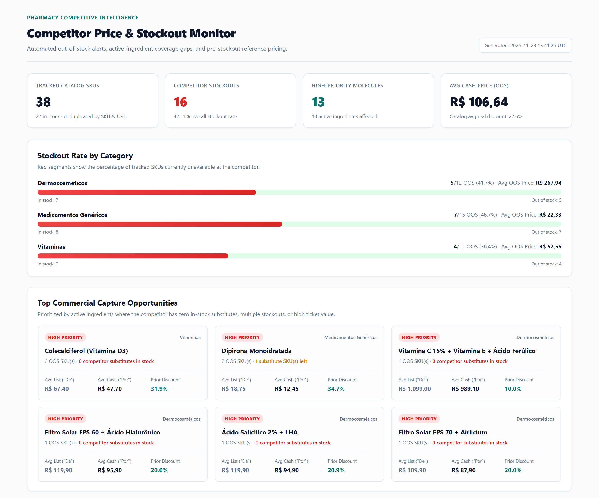
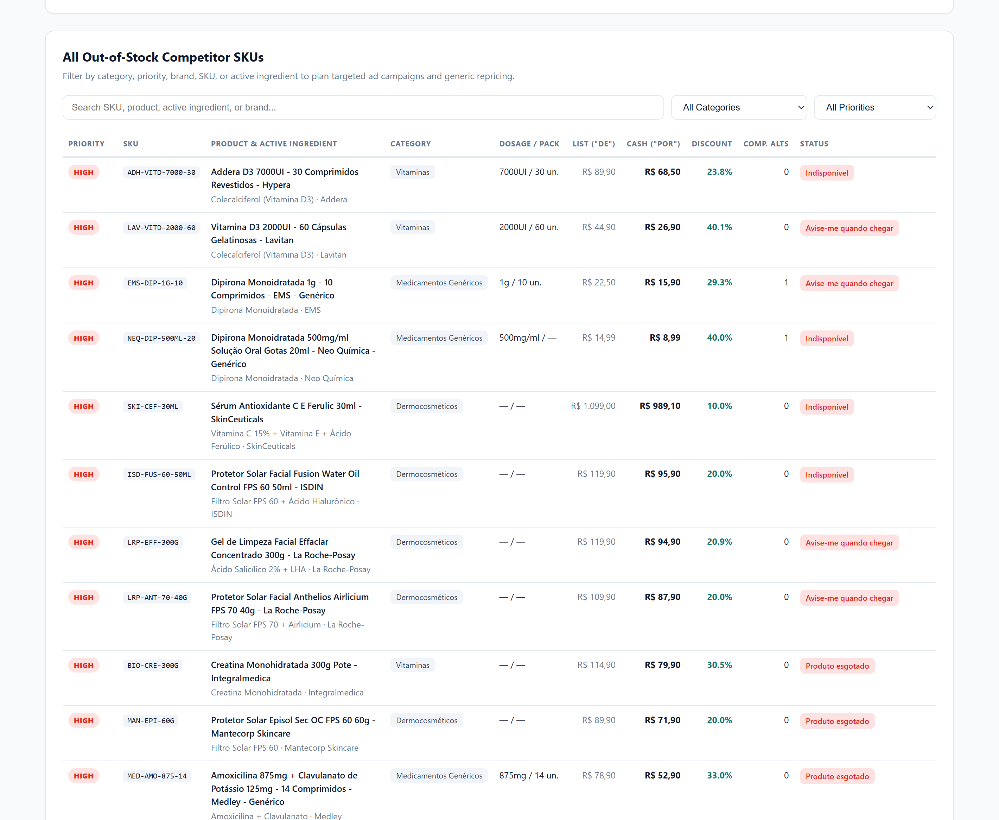
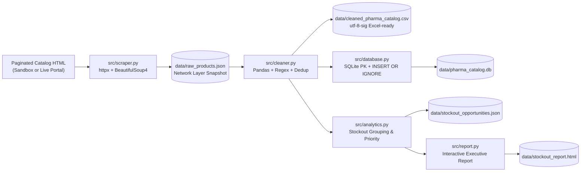

# Pharmacy Competitor Stock & Price Tracker

An automated, production-structured Python ETL pipeline that monitors competitor pharmacy catalogs, normalizes unstructured pharmaceutical titles (dosages, concentrations, pack sizes), calculates true cash vs. list discounts, and surfaces **out-of-stock commercial opportunities** in Excel-ready CSV, JSON, SQLite, and a standalone interactive HTML executive report.

---

## Visual Report Preview

Running the pipeline automatically generates a standalone, interactive executive dashboard (`data/stockout_report.html`) that commercial teams can open directly in any browser:

### Executive Overview & Top Stockout Opportunities


### Filterable Out-of-Stock SKU Table


---

## Business Problem & Value

Regional pharmacy chains, compounding pharmacies, and healthcare distributors lose high-intent sales whenever they lack visibility into competitor inventory gaps. When a major chain runs out of an essential generic medication, supplement, or dermocosmetic SKU, agile competitors can immediately:

- **Capture high-intent demand** by increasing ad bids on active ingredients currently unavailable at rival stores.
- **Optimize generic pricing & margins** using the competitor's pre-stockout list ("De") and cash ("Por") reference prices.
- **Eliminate manual catalog checks** with an idempotent daily pipeline that feeds directly into Excel, BI dashboards, or internal repricing scripts.

---

## Key Capabilities

- **Polite, Modular HTTP Extraction (`src/scraper.py`)**: Uses `httpx` with realistic browser headers (`User-Agent`, `Accept-Language`), automatic pagination traversal, retry with exponential backoff, and configurable `1–2s` inter-page rate-limiting. Supports configurable CSS selectors plus automatic `Schema.org JSON-LD` fallback for external static-HTML portals, and isolates network output to `data/raw_products.json`.
- **Reproducible Local Sandbox Server (`src/sandbox_server.py`)**: Ships with an embedded multi-page static-HTML pharmacy server (*Generic Medications*, *Vitamins*, *Dermocosmetics*) so anyone can run the entire HTTP scraping and ETL pipeline end-to-end with zero external flakiness.
- **Pharmaceutical Text & Price Normalization (`src/cleaner.py`)**:
  - Cleans currency symbols, Brazilian/international decimal & thousand separators (`R$ 1.099,00`, `R$ 11,49 à vista`), and parses installment offers (`3x de R$ 29,97`).
  - Computes real percentage discount:
    $$\text{Discount Pct} = \frac{\text{List Price} - \text{Cash Price}}{\text{List Price}} \times 100$$
  - Extracts structured numeric attributes via Regex: `dosage_mg` (normalizing `mg`, `mcg`, and small-dose `g` ≤ 10g to milligrams), `package_units` (tablets, capsules, sachets, units), `volume_ml`, `weight_g`, and `price_per_unit`.
  - Normalizes raw availability labels (`"Em estoque"`, `"Avise-me quando chegar"`, `"Indisponível"`, `"Produto esgotado"`) to boolean `is_in_stock`.
  - Deduplicates cross-page product listings by `sku` and `product_url`, exporting `data/cleaned_pharma_catalog.csv` in `utf-8-sig` (opens cleanly in Microsoft Excel without broken accents).
- **Competitive Stockout Intelligence (`src/analytics.py`)**: Filters out-of-stock SKUs (`is_in_stock == False`), groups by category and active ingredient, counts remaining in-stock competitor substitutes per molecule, assigns `HIGH` / `MEDIUM` priority, and exports `data/stockout_opportunities.json`.
- **Standalone Visual Executive Report (`src/report.py`)**: Generates `data/stockout_report.html` — a zero-dependency interactive dashboard with KPI cards, category stockout rate bars, top commercial opportunities, and a searchable/filterable out-of-stock SKU table.
- **Idempotent Relational Persistence (`src/database.py`)**: Stores cleaned records in SQLite (`data/pharma_catalog.db`) with `sku TEXT PRIMARY KEY`, analytical indexes, and `INSERT OR IGNORE` semantics for safe daily re-runs.

---

## Pipeline Architecture



---

## Repository Structure

```text
pharma-competitor-stock-price-tracker/
├── data/
│   ├── raw_products.json             # Raw scraped snapshot (isolated network layer)
│   ├── cleaned_pharma_catalog.csv    # Deduplicated, Excel-ready catalog (utf-8-sig)
│   ├── stockout_opportunities.json   # Prioritized stockout alerts by active ingredient
│   ├── stockout_report.html          # Standalone interactive visual HTML report
│   └── pharma_catalog.db             # Idempotent SQLite database (sku PRIMARY KEY)
├── docs/
│   └── screenshots/
│       ├── dashboard-overview.png    # Executive KPI & opportunity cards screenshot
│       └── stockout-table.png        # Filterable out-of-stock SKU table screenshot
├── src/
│   ├── __init__.py
│   ├── sandbox_server.py             # Local paginated static-HTML pharmacy catalog server
│   ├── scraper.py                    # Modular HTTP client, pagination & HTML/JSON-LD parser
│   ├── cleaner.py                    # Pandas + Regex normalization & deduplication
│   ├── analytics.py                  # Stockout intelligence & priority scoring
│   ├── report.py                     # Standalone visual HTML dashboard generator
│   └── database.py                   # SQLite schema, indexes & INSERT OR IGNORE loader
├── run_pipeline.py                   # End-to-end CLI entrypoint
├── requirements.txt
└── README.md
```

---

## Quick Start

### 1. Set Up the Virtual Environment

**Windows (PowerShell):**

```powershell
python -m venv .venv
.\.venv\Scripts\pip install -r requirements.txt
```

**macOS / Linux:**

```bash
python3 -m venv .venv
.venv/bin/pip install -r requirements.txt
```

### 2. Run the Full Pipeline (Local HTTP Sandbox Mode)

```powershell
.\.venv\Scripts\python run_pipeline.py
```

This starts the local paginated pharmacy server, scrapes 6 HTML pages across 3 categories with `1–2s` delays, cleans and deduplicates the catalog, builds the JSON and HTML stockout reports, and loads SQLite.

### 3. Reprocess Offline & Verify SQLite Idempotency

```powershell
.\.venv\Scripts\python run_pipeline.py --source cached
```

Skips the HTTP layer and re-runs Stages 2–4 directly from `data/raw_products.json` — confirming `inserted=0, ignored=38` in SQLite.

### 4. Point to an Authorized Live Static-HTML Portal

```powershell
.\.venv\Scripts\python run_pipeline.py \
  --source live \
  --base-url https://authorized-pharmacy-portal.example.com \
  --categories /category/generics /category/vitamins
```

> **Tip:** To adapt to a specific client website, customize `SelectorConfig` in `src/scraper.py` (or rely on the built-in `Schema.org JSON-LD` fallback when the portal embeds structured product markup).

---

## Sample Output

### CLI Execution Summary

```text
========================================================================
PHARMA COMPETITOR STOCK & PRICE TRACKER - PIPELINE SUMMARY
========================================================================
Raw records extracted : 41
Unique SKUs cleaned   : 38
In-stock SKUs         : 22
Out-of-stock SKUs     : 16 (42.11% stockout rate)
High-priority alerts  : 13 active ingredients
SQLite persistence    : inserted=38, ignored=0, total_rows=38
------------------------------------------------------------------------
Top Stockout Opportunities (Priority / Active Ingredient / Avg Cash Price):
  [HIGH  ] Colecalciferol (Vitamina D3) (Vitaminas) | 2 OOS | Competitor alt: 0 | Ref: R$ 47.70
  [HIGH  ] Dipirona Monoidratada (Medicamentos Genéricos) | 2 OOS | Competitor alt: 1 | Ref: R$ 12.45
  [HIGH  ] Vitamina C 15% + Vitamina E + Ácido Ferúlico (Dermocosméticos) | 1 OOS | Competitor alt: 0 | Ref: R$ 989.10
  [HIGH  ] Filtro Solar FPS 60 + Ácido Hialurônico (Dermocosméticos) | 1 OOS | Competitor alt: 0 | Ref: R$ 95.90
  [HIGH  ] Ácido Salicílico 2% + LHA (Dermocosméticos) | 1 OOS | Competitor alt: 0 | Ref: R$ 94.90
========================================================================
```

### Deliverables Generated

| Artifact | Audience | Purpose |
| :--- | :--- | :--- |
| `data/stockout_report.html` | Commercial / Marketing Teams | Interactive browser dashboard with KPIs, category bars, and searchable OOS table |
| `data/cleaned_pharma_catalog.csv` | Pricing Analysts (Excel / BI) | Normalized dosages, unit counts, cash vs. list discounts (`utf-8-sig`) |
| `data/stockout_opportunities.json` | Ad Ops / Automation Scripts | Structured JSON feed grouped by active ingredient and priority |
| `data/pharma_catalog.db` | Data Engineering / Analytics | Idempotent SQLite store with `sku` as `PRIMARY KEY` |

---

## Tech Stack

- **Python 3.10+**
- **httpx** — HTTP client with timeout, redirects, and custom headers
- **BeautifulSoup4** — Static HTML & JSON-LD parsing
- **Pandas & Regex** — Vectorized data cleaning, unit extraction, and deduplication
- **SQLite (`sqlite3`)** — Zero-configuration relational storage with primary-key idempotency
